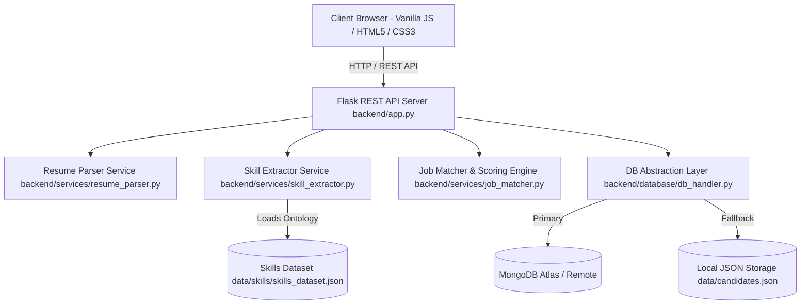
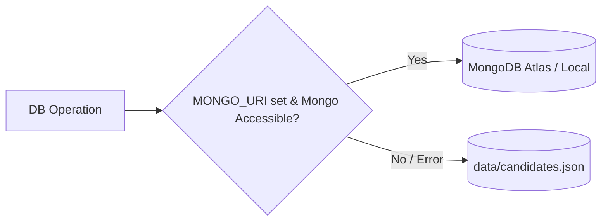

# 🤖 AI Resume Analyzer — Senior Engineer Project Context Report

> **Author**: Senior Software Engineer  
> **Target Audience**: Software Engineers, Technical Lead, Data/NLP Engineers, AI Agents  
> **Repository Path**: `c:/Users/HENIL/OneDrive/Desktop/ai-resume-analyzer (2)/ai-resume-analyzer`  
> **Last Updated**: August 2026  

---

## 📋 Executive Summary

The **AI Resume Analyzer** is an end-to-end, cloud-ready Applicant Tracking System (ATS) decision-support engine. It automates resume parsing (PDF, DOCX, TXT), extracts technological competencies and experience using Natural Language Processing (NLP), and ranks candidates against customized job requirements using a hybrid scoring algorithm (Keyword Phrase Matching + Sentence-BERT Semantic Embeddings + Experience Heuristics).

### Core Problem Solved
Manual resume screening is slow, inconsistent, and error-prone. This application provides HR recruiters and technical hiring managers with automated multi-signal candidate ranking, side-by-side comparisons, skill gap analysis, and candidate shortlist management in a single buildless, lightweight web interface.

---

## 🏗 High-Level System Architecture

The project follows a decoupled client-server architecture with dual-mode data persistence and scalable containerization options.



---

## 📂 Repository Structure & Component Map

```
ai-resume-analyzer/
├── backend/
│   ├── app.py                      # Flask HTTP Server & API Routes
│   ├── database/
│   │   └── db_handler.py           # MongoDB driver with local JSON fallback
│   ├── services/
│   │   ├── resume_parser.py        # Multi-format document text & entity parser
│   │   ├── skill_extractor.py      # spaCy PhraseMatcher NLP skill taxonomy engine
│   │   └── job_matcher.py          # Multi-signal scoring engine & BERT semantic matcher
│   ├── utils/                      # Reserved directory for helper modules
│   ├── .env.example                # Template for environment configuration
│   └── requirements.txt            # Python backend dependencies
├── frontend/
│   ├── index.html                  # Single-Page UI layout & modal structures
│   ├── app.js                      # Client-side state machine, API fetcher, UI logic
│   └── styles.css                  # Modern UI tokens, responsive 3-column layout
├── data/
│   ├── candidates.json             # Local JSON database (fallback storage)
│   ├── resumes/                    # Staged uploaded resume documents
│   └── skills/
│       └── skills_dataset.json     # 200+ skill taxonomy mapped to 12 tech domains
├── deployment/
│   └── Dockerfile                  # Container build instructions (Python 3.11 + Gunicorn)
├── setup.sh                        # Automated environment bootstrap script
├── README.md                       # High-level overview & quickstart guide
└── PROJECT_CONTEXT_REPORT.md       # Senior Engineer Full Technical Context Report
```

---

## 🔁 End-to-End Execution & Data Flows

### 1. Single & Batch Resume Analysis Flow

```mermaid
sequenceDiagram
    autonumber
    actor User
    participant Frontend as [app.js](file:///c:/Users/HENIL/OneDrive/Desktop/ai-resume-analyzer%20%282%29/ai-resume-analyzer/frontend/app.js)
    participant Flask as [app.py](file:///c:/Users/HENIL/OneDrive/Desktop/ai-resume-analyzer%20%282%29/ai-resume-analyzer/backend/app.py)
    participant Parser as [resume_parser.py](file:///c:/Users/HENIL/OneDrive/Desktop/ai-resume-analyzer%20%282%29/ai-resume-analyzer/backend/services/resume_parser.py)
    participant Extractor as [skill_extractor.py](file:///c:/Users/HENIL/OneDrive/Desktop/ai-resume-analyzer%20%282%29/ai-resume-analyzer/backend/services/skill_extractor.py)
    participant Matcher as [job_matcher.py](file:///c:/Users/HENIL/OneDrive/Desktop/ai-resume-analyzer%20%282%29/ai-resume-analyzer/backend/services/job_matcher.py)
    participant DB as [db_handler.py](file:///c:/Users/HENIL/OneDrive/Desktop/ai-resume-analyzer%20%282%29/ai-resume-analyzer/backend/database/db_handler.py)

    User->>Frontend: Submits Job Description, Required Skills, Exp, & Resumes
    Frontend->>Flask: POST /analyze-batch (multipart/form-data)
    loop For each resume file
        Flask->>Parser: parse_resume(file_path)
        Parser-->>Flask: {raw_text, clean_text, email, phone, name, word_count}
        Flask->>Extractor: extract_skills(clean_text) & categorize
        Extractor-->>Flask: skills_found, skills_by_category, experience_years, education
        Flask->>Matcher: calculate_match_score & calculate_semantic_score (BERT)
        Matcher-->>Flask: keyword_score, semantic_score, final_score, strengths, weaknesses, summary
        Flask->>DB: save_candidate(record)
        DB-->>Flask: candidate_id
    end
    Flask-->>Frontend: HTTP 200 JSON ({candidates: [...], total, errors})
    Frontend->>User: Displays Candidates in 3-Column Results View
```


---

## 🔬 Core Service Modules — Deep Dive

### 1. File Parsing Service (`backend/services/resume_parser.py`)
- **PDF Extraction**: Primary extraction via `PyPDF2.PdfReader`. Built-in fallback to `pdfminer.high_level.extract_text` if PDF syntax or encoding fails.
- **DOCX Extraction**: Powered by `python-docx` (`docx.Document`).
- **TXT Extraction**: Direct raw read with `errors="ignore"` flag.
- **Text Normalization (`clean_text`)**: Converts text to lowercase, strips noise punctuation (retaining `.` `+` `#` for C++, C#, .NET), and collapses redundant whitespace.
- **Regex Extraction**:
  - `Email`: `[a-zA-Z0-9._%+-]+@[a-zA-Z0-9.-]+\.[a-zA-Z]{2,}`
  - `Phone`: `[\+]?[(]?[0-9]{3}[)]?[-\s\.]?[0-9]{3}[-\s\.]?[0-9]{4,6}`
  - `Name Heuristic`: Scans the top 5 lines of raw text, excluding strings containing `@`, `.com`, `http`, `+91`, `+1`. Selects title-cased line with 2–5 words.

### 2. Skill Extraction Engine (`backend/services/skill_extractor.py`)
- **Taxonomy Database**: Loaded from `data/skills/skills_dataset.json`, containing 200+ canonical technical skills categorized into 12 domains:
  1. `programming_languages` (Python, C++, Rust, Go, TypeScript, etc.)
  2. `web_frontend` (React, Vue, Next.js, Tailwind, HTML, etc.)
  3. `web_backend` (Node.js, Flask, Django, Spring Boot, etc.)
  4. `databases` (SQL, PostgreSQL, MongoDB, Redis, etc.)
  5. `data_science` (Machine Learning, NLP, Computer Vision, etc.)
  6. `ml_frameworks` (PyTorch, TensorFlow, spaCy, Scikit-Learn, etc.)
  7. `cloud` (AWS, Azure, GCP, Lambda, S3, etc.)
  8. `devops` (Docker, Kubernetes, CI/CD, Terraform, etc.)
  9. `tools` (Git, Jira, Postman, Google Colab, etc.)
  10. `soft_skills` (Agile, Problem Solving, Leadership, etc.)
  11. `cybersecurity` (Penetration Testing, OAuth, JWT, etc.)
  12. `mobile` (React Native, Flutter, Swift, Kotlin, etc.)
- **spaCy PhraseMatcher**: Uses `en_core_web_sm` model token vocab with `attr="LOWER"` to perform efficient O(N) multi-word phrase matching across up to 100k characters.
- **Experience Years Parser**: Regex engine searching for patterns like `(\d+)\+?\s*years?\s*experience`, identifying maximum years while filtering values > 50.
- **Education Level Detector**: Heuristic keyword classification detecting `PhD`, `Masters`, `Bachelors`, `Diploma/Certificate`, or `Not specified`.

### 3. Job Matcher & Scoring Engine (`backend/services/job_matcher.py`)
The scoring system combines multiple weighted signals to produce a normalized 0–100 match score:

$$\text{Final Score} = (0.60 \times \text{Keyword Score}) + (0.30 \times \text{Semantic Score}) + (0.10 \times \text{Experience Score})$$

> **Note**: If `sentence-transformers` is absent or semantic calculation is skipped, the system dynamically reweights to:  
> $\text{Final Score} = (0.90 \times \text{Keyword Score}) + (0.10 \times \text{Experience Score})$

#### Component Formula Breakdown:
1. **Keyword Match Score ($S_k$)**:  
   $$S_k = \frac{|\text{Resume Skills} \cap \text{Required Skills}|}{|\text{Required Skills}|} \times 100$$
2. **Semantic Similarity Score ($S_s$)**:  
   Uses `sentence-transformers/all-MiniLM-L6-v2` to compute PyTorch cosine similarity between the first 1000 characters of the candidate resume and the job description:  
   $$S_s = \max(0, \cos(\mathbf{e}_{\text{resume}}, \mathbf{e}_{\text{jd}})) \times 100$$
3. **Experience Match Score ($S_e$)**:  
   $$S_e = \begin{cases} 100.0 & \text{if } Y_{\text{actual}} \ge Y_{\text{required}} \text{ or } Y_{\text{required}} = 0 \\ \frac{Y_{\text{actual}}}{Y_{\text{required}}} \times 100 & \text{otherwise} \end{cases}$$

#### Qualitative Match Tiers:
- **Strong Match** ($\ge 80\%$): Highly recommended for interview (Green)
- **Good Match** ($60 - 79\%$): Meets most core requirements (Blue)
- **Partial Match** ($40 - 59\%$): Relevant skills, key gaps exist (Orange)
- **Weak Match** ($< 40\%$): Does not meet baseline requirements (Red)

#### Automated Decision Support Generators:
- `generate_strengths()`: Synthesizes top 3 candidate attributes (e.g., skill coverage, senior experience, advanced degree).
- `generate_weaknesses()`: Highlights top missing requirements or experience deficits.
- `generate_resume_summary()`: Generates a 3-sentence recruiter summary.
- `compare_candidates()`: Computes relative advantages between 2 candidates and outputs winner recommendation logic.

---

## 💾 Database Layer & Resilience Design (`backend/database/db_handler.py`)

The application incorporates a **Zero-Downtime Storage Fallback Pattern**:



- **Primary Mode (MongoDB)**: When `MONGO_URI` is provided in `.env`, the app connects using `pymongo.MongoClient` with a 3000ms timeout threshold. Collections are stored under `DB_NAME` (default: `resume_analyzer`).
- **Fallback Mode (Local JSON)**: If MongoDB connection fails or `MONGO_URI` is blank, operations fall back seamlessly to reading and writing `data/candidates.json`.

---

## 💻 Web Frontend Architecture (`frontend/`)

Built using pure Vanilla JavaScript (ES6+), semantic HTML5, and CSS custom properties without external bundlers (Vite/Webpack) or UI frameworks (React/Vue).

### Key Frontend Components & State:
- `allCands`: Master candidate array in client memory.
- `filteredCands`: Filtered and sorted slice rendered in the DOM.
- `selectedIds`: Set tracking selected candidates for side-by-side modal comparison.
- **View Navigation**:
  - `upload-view`: Dual-step upload portal featuring drag-and-drop file dropzone.
  - `results-view`: 3-Column interactive recruiter workspace:
    - **Left Column**: Live range slider filters for Score ($\ge X\%$), Experience ($\ge Y$ yrs), and categorical skill checkboxes.
    - **Center Column**: Rendered Candidate Cards displaying score badge, top skills, shortlist status actions (`Shortlist`, `Reject`, `Maybe`), and multi-attribute search bar.
    - **Right Column**: Detailed Candidate Profile Drawer displaying match progress bars, full skill breakdown, summary, and qualitative insights.
  - **Comparison Modal**: Floating side-by-side comparison matrix with automated winner recommendation banner.

---

## 📡 REST API Reference Guide

Base URL: `http://localhost:5000`

| Endpoint | Method | Request Payload | Response Schema | Description |
| :--- | :---: | :--- | :--- | :--- |
| `/health` | `GET` | None | `{"status": "ok", "message": "..."}` | API availability check |
| `/analyze` | `POST` | `multipart/form-data`<br>`resume`: File<br>`required_skills`: String<br>`required_experience`: Int<br>`job_description`: String | Candidate JSON Object with scores & insights | Processes single resume |
| `/analyze-batch` | `POST` | `multipart/form-data`<br>`resumes`: File[]<br>`required_skills`: String<br>`required_experience`: Int<br>`job_description`: String | `{"candidates": [...], "total": N, "errors": [...]}` | Processes multiple resumes concurrently |
| `/candidates` | `GET` | None | `Candidate[]` (sorted by score DESC) | Retrieves all saved candidates |
| `/candidates/<id>` | `GET` | URL param `id` | `Candidate` JSON object | Retrieves single candidate profile |
| `/candidates/<id>/status`| `PATCH`| `{"status": "shortlisted" \| "rejected" \| "maybe" \| null}` | `{"message": "...", "status": "..."}` | Updates recruiter decision status |
| `/compare` | `POST` | `{"id1": "...", "id2": "..."}` | `{"candidate_1": {...}, "candidate_2": {...}, "recommendation": "..."}` | Side-by-side comparison |
| `/candidates/<id>` | `DELETE`| URL param `id` | `{"message": "Candidate deleted"}` | Removes candidate record |
| `/clear` | `DELETE`| None | `{"message": "All candidates cleared"}` | Wipes database (dev/testing) |

---

## ⚙️ Environment Configuration

Configuration template located at `backend/.env.example`:

```env
# Server Port
PORT=5000

# Database Configuration (Leave MONGO_URI blank for local JSON storage)
MONGO_URI=mongodb+srv://<user>:<password>@cluster.mongodb.net/
DB_NAME=resume_analyzer

# AWS S3 Document Storage (Optional)
AWS_ACCESS_KEY_ID=
AWS_SECRET_ACCESS_KEY=
AWS_BUCKET_NAME=
AWS_REGION=us-east-1
```

---

## 🚀 Setup & Local Execution Guide

### Prerequisites
- Python 3.11+
- pip & virtualenv

### 1. Automated Setup Script (macOS / Linux / WSL / Git Bash)
```bash
# Run setup script from repository root
bash setup.sh
```

### 2. Manual Installation Steps (Windows PowerShell / CMD)
```powershell
# Navigate to backend
cd backend

# Create virtual environment
python -m venv venv

# Activate virtual environment
.\venv\Scripts\Activate.ps1

# Install requirements
pip install -r requirements.txt

# Download required spaCy model
python -m spacy download en_core_web_sm

# Copy environment settings
copy .env.example .env

# Run application
python app.py
```

### 3. Accessing the Web Application
1. Backend REST API runs on `http://localhost:5000`
2. Open `frontend/index.html` directly in any standard browser (Chrome, Firefox, Edge, Safari).

---

## 🐳 Docker Deployment (`deployment/Dockerfile`)

The project includes production-ready Docker packaging built on `python:3.11-slim` with `Gunicorn` WSGI application server (2 worker processes).

```bash
# Build Docker image
docker build -f deployment/Dockerfile -t resume-analyzer .

# Run Docker container
docker run -d -p 5000:5000 --name resume-analyzer-container resume-analyzer
```

---

## 🔮 Senior Engineer Roadmap & Architectural Recommendations

1. **Asynchronous Queueing (Celery / Redis / AWS SQS)**:
   - *Current limitation*: Synchronous CPU-bound parsing and BERT vector encoding on HTTP request threads (`app.py`).
   - *Recommendation*: Offload document parsing and vector inference to background workers with WebSocket status callbacks.
2. **Vector Database Integration (Qdrant / Pinecone / ChromaDB)**:
   - *Current limitation*: In-memory cosine similarity encoding per request (`job_matcher.py`).
   - *Recommendation*: Store pre-computed resume embeddings in a vector database for instantaneous semantic similarity search across large resume pools.
3. **LLM Integration (GPT-4o / Claude 3.5 / Gemini)**:
   - Introduce generative AI prompts to generate tailored resume improvement suggestions, ATS optimization feedback, and personalized interview questions.
4. **Structured Testing & CI/CD Pipeline**:
   - Introduce `pytest` test suites for `resume_parser`, `skill_extractor`, and `job_matcher` scoring logic.
   - Set up GitHub Actions workflow for automated linting, test execution, and Docker container builds.

---
*Report generated for AI Resume Analyzer project context onboarding.*
