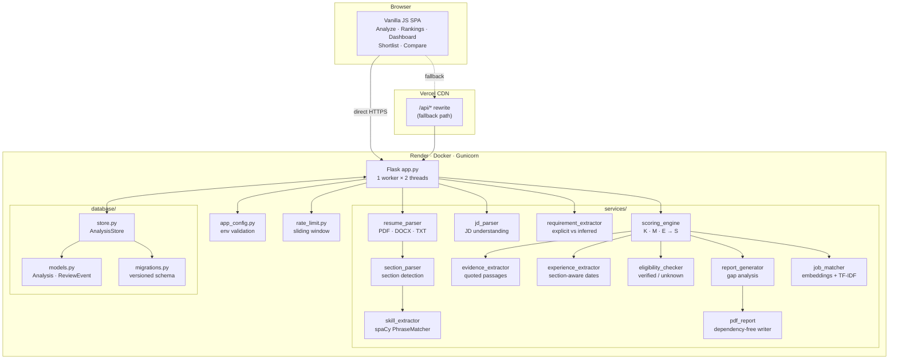
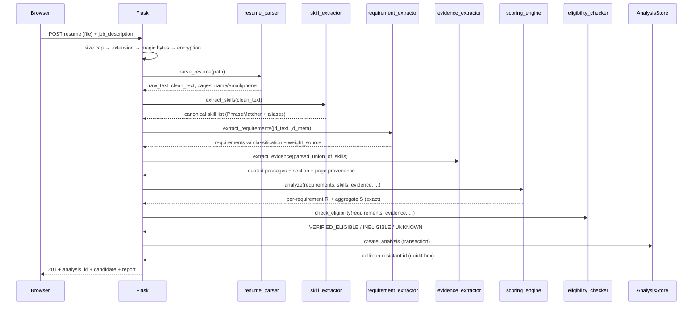
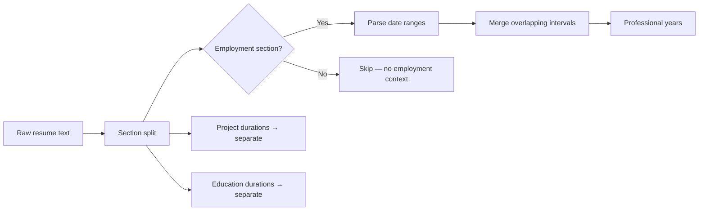
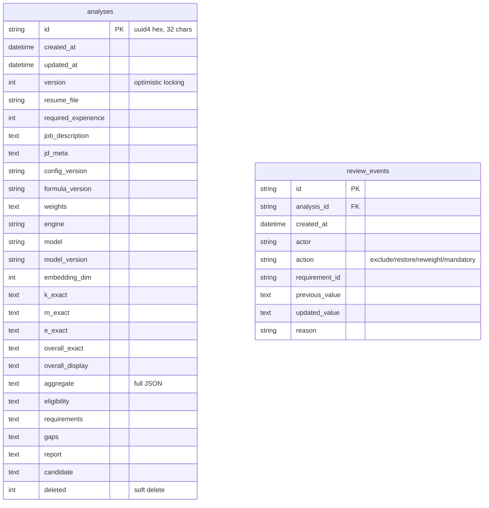
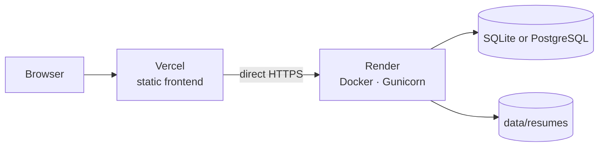

# AI Resume Analyzer — Complete Project Documentation

> Full technical record of the project: what it does, how it works, every
> technology used and why, the architecture, the algorithms, the deployment
> story, the engineering journey (including real bugs found and fixed), and
> honest limitations.
>
> Snapshot: config version **2.0.0**, formula version **explainable-v2**,
> **212 automated tests passing**, ~10,000 lines of Python + ~1,840 lines of
> frontend.

---

## Table of Contents

1. [Project Overview](#1-project-overview)
2. [The Problem It Solves](#2-the-problem-it-solves)
3. [Technology Stack](#3-technology-stack)
4. [System Architecture](#4-system-architecture)
5. [Request Lifecycle (End to End)](#5-request-lifecycle-end-to-end)
6. [Core Modules In Depth](#6-core-modules-in-depth)
7. [The Scoring Engine](#7-the-scoring-engine)
8. [Semantic Engine & Evaluation](#8-semantic-engine--evaluation)
9. [Database & Persistence](#9-database--persistence)
10. [API Reference](#10-api-reference)
11. [Frontend](#11-frontend)
12. [PDF Report Generation](#12-pdf-report-generation)
13. [Security](#13-security)
14. [Deployment](#14-deployment)
15. [Testing](#15-testing)
16. [Engineering Journey — Bugs Found & Fixed](#16-engineering-journey--bugs-found--fixed)
17. [Project Statistics](#17-project-statistics)
18. [Limitations & Future Work](#18-limitations--future-work)
19. [Complete File Map](#19-complete-file-map)

---

## 1. Project Overview

**AI Resume Analyzer** is a Flask-based applicant-tracking and candidate
screening system. It parses resumes (PDF/DOCX/TXT) and job descriptions,
extracts structured requirements and skills, and produces an **explainable**
compatibility score — meaning every number can be traced back to the exact
resume sentence that justified it.

What makes it different from a typical resume-screening tool:

- **Every score is auditable.** A requirement only scores well if there is a
  real quoted passage from the resume supporting it.
- **Honest unknowns.** Missing information produces `UNKNOWN`, never a
  guessed pass or fail.
- **Correct measurement of experience.** A two-month internship counts as
  ~0.17 years, never "3 years". Projects and education are reported
  separately from employment.
- **Human-in-the-loop review.** A recruiter can exclude a wrongly-extracted
  requirement or correct a weight, and the system rescores and records an
  append-only audit trail.

---

## 2. The Problem It Solves

Recruiters using keyword-matching ATS tools get misled constantly:

| Real-world failure | How this project handles it |
|---|---|
| A 2-month internship counted as 3 years of experience | Section-aware date parsing, interval merging, separate buckets |
| "React" listed as proof the candidate knows ASP.NET | Evidence must name the *same canonical skill* |
| Candidate marked "ineligible" just for missing a skill | Eligibility vs. skill gaps are separate concepts |
| A score that changes every time you refresh it | Full-precision single source of truth; display rounding only |
| Duplicate education/project dates inflating experience | Overlapping intervals merged, education excluded |
| Invented requirements the JD never stated | Explicit vs. inferred classification with `weight_source` |

---

## 3. Technology Stack

### 3.1 Backend

| Technology | Version | Why it was chosen |
|---|---|---|
| **Python** | 3.11 | Ecosystem for NLP + ML; async-free simplicity suits request/response |
| **Flask** | 3.0.0 | Lightweight REST API; easy to serve both API and static frontend |
| **spaCy** | 3.7.2 | Fast `PhraseMatcher` over a 191-skill taxonomy; industrial-strength tokenization |
| **en_core_web_sm** | 3.7.1 | Small English pipeline (~12MB) that fits in 512MB RAM; NER for name extraction |
| **PyPDF2** | 3.0.1 | PDF text + page extraction, encryption detection |
| **pdfminer.six** | 20221105 | Higher-fidelity text extraction fallback for PDFs PyPDF2 mangles |
| **python-docx** | 1.1.0 | DOCX parsing (XML-based) |
| **NumPy** | 1.26.4 | Vector math for TF-IDF embeddings and cosine similarity |
| **SQLAlchemy** | 2.1.4 | ORM + transactions + migrations for the analysis store |
| **PyYAML** | 6.0.1 | Scoring configuration as a versioned YAML file |
| **Flask-CORS** | 4.0.0 | Cross-origin access for the Vercel-hosted frontend |
| **Gunicorn** | 21.2.0 | Production WSGI server; thread pool + worker timeout control |
| **python-dotenv** | 1.0.0 | Environment configuration |
| **pytest** | 9.1.1 | Test framework for the 212-test suite |
| **pymongo** | 4.6.1 | Optional MongoDB backend for the legacy candidate list |

### 3.2 Semantic engine (dual, with a deliberate fallback)

| Technology | Status | Why |
|---|---|---|
| **BAAI/bge-small-en-v1.5** | Local dev | 384-dim embeddings, 33M params — strong retrieval-style similarity at small size |
| **sentence-transformers 2.3.1** | Local dev only | Simple `SentenceTransformer.encode()` API |
| **TF-IDF cosine** (custom) | **Production** | Dependency-free; no torch; fits free-tier RAM |

The custom TF-IDF engine lives in `services/job_matcher.py::_TfidfEmbedder`. It
fits its vocabulary/IDF once (seeded with the skill taxonomy), then **freezes**
it — critical, because separately-encoded JD and resume matrices must share one
vector space.

### 3.3 Frontend

| Technology | Why |
|---|---|
| **Vanilla JS** (no framework) | Zero build step, no CDN dependency, deployable as static files |
| **HTML5 + CSS** (custom properties) | Design tokens via CSS variables for theming |
| **Canvas/SVG** | Dashboard donut + bar charts drawn manually |
| **Vercel** | Static hosting with edge rewrites |
| **Fetch API + AbortController** | Request timeouts and cancellation for slow cold starts |

### 3.4 Infrastructure

| Technology | Role |
|---|---|
| **Docker** | Reproducible container image |
| **Render** | Backend hosting (free tier) |
| **Vercel** | Frontend hosting |
| **GitHub Actions** | CI — installs deps, runs 212 tests + evaluation |
| **SQLite / PostgreSQL** | Analysis store (dev / production) |

---

## 4. System Architecture



### Design principles

1. **Single source of truth.** The headline score is computed once, stored
   full-precision, and served identically by the API, the JSON export, the
   PDF, and the frontend. Nothing recomputes it.
2. **Display-only rounding.** Internal math is full float precision; rounding
   happens once, at the very end.
3. **Additive explainability.** The legacy score fields remain for backward
   compatibility; the explainable layer is attached additively and never
   breaks existing contracts.
4. **Fail loudly, never fake.** Missing model → `status: model-unavailable`,
   never a fabricated zero that looks like a real measurement.

---

## 5. Request Lifecycle (End to End)

A `POST /api/v1/analyses` flows like this:



**Two-pass batch processing** (`/analyze-batch`): Pass 1 parses every resume
and saves it; Pass 2 computes an IDF (inverse document frequency) across *this
applicant pool* so rare skills weigh more, then scores everyone. This means a
skill mentioned by all applicants contributes less than one only a few have.

---

## 6. Core Modules In Depth

### 6.1 `resume_parser.py` (202 lines)
Multi-format text extraction with layered fallbacks. PDF goes PyPDF2 first,
then pdfminer.six; DOCX via python-docx; TXT with UTF-8 validation.
Computes `raw_text` (preserves newlines and section headers) and `clean_text`
(normalized whitespace for matching). Detects scanned/image-only PDFs via
`MIN_WORDS_FOR_VALID_DOC` and returns an OCR hint rather than a zero score.

### 6.2 `section_parser.py` (162 lines)
Splits raw resume text into named sections using header regexes. This is the
foundation of accurate experience detection — without it, dates are just
numbers floating in a wall of text.

### 6.3 `skill_extractor.py` (163 lines)
Builds a spaCy `PhraseMatcher` over the 191-skill taxonomy plus all known
aliases (so "k8s" → Kubernetes, "js" → JavaScript). Resilient model loader:
tries `spacy.load`, falls back to a time-boxed download, then to
`spacy.blank("en")` — the matcher only needs tokenization, so extraction keeps
working even with no model at all.

### 6.4 `skill_aliases.py` (142 lines)
Canonical-skill normalization plus a one-way `domain_covers()` relation:
- `mysql` **covers** `sql` ✅ (a MySQL query is SQL)
- `sql` does **not** cover `mysql` ❌ (SQL knowledge ≠ MySQL specifically)

One-way on purpose. Symmetric aliasing would let generic skills claim
specific ones and inflate scores.

### 6.5 `jd_parser.py` (281 lines)
Turns a free-form job description into structured metadata: title, summary,
key points, minimum experience, education requirement, per-skill weights. Uses
`SECTION_BREAKERS` so "Required Skills" blocks terminate cleanly. **Critical
behaviour:** an "Education Requirements" section no longer resets the must-have
set — this previously made ASP.NET a mandatory Java requirement.

### 6.6 `requirement_extractor.py` (169 lines)
Produces classified requirements:
- `classification`: explicit / inferred / irrelevant
- `weight_source`: explicit / inferred / reviewed
- `mandatory` + `mandatory_source`
- Duplicate groups collapse so "REST API" and "RESTful APIs" appear once

### 6.7 `evidence_extractor.py` (140 lines)
Finds *quoted passages* proving each requirement. Two properties make this
trustworthy:
- **Section + page provenance** is preserved for every span
- **Skill-list vs. demonstrated implementation** are distinguished via a
  `skill_list` flag — listing "React" in a skills section is not the same as
  describing React work

Evidence is gathered for the **union** of JD requirement skills *and* resume
skills, so a requirement like "SQL" still finds support when the resume says
"MySQL".

### 6.8 `experience_extractor.py` (272 lines)
The most bug-prone module, and the one with the clearest design rules:



- Only **employment sections** count as professional experience
- Bare date ranges outside an employment section are ignored
- Overlapping intervals merge (two concurrent jobs ≠ double-counted)
- Month-level precision supported
- Unverifiable claims produce `unknown`/`low confidence` with a reason, never
  an invented number

**Verified behaviour:** a 2-month internship → `0.17 years` professional,
`2.0 years` project, `5.0 years` education — reported separately.

### 6.9 `eligibility_checker.py` (187 lines)
Strictly separated from compatibility scoring.

| Status | When |
|---|---|
| `VERIFIED_ELIGIBLE` | All explicit source-backed rules pass |
| `VERIFIED_INELIGIBLE` | An explicit JD rule (degree bar, backlog, work auth) is demonstrably violated |
| `UNKNOWN` | Required facts absent from the resume |

**Skill gaps never cause ineligibility.** A missing skill is a *compatibility*
signal, not an *eligibility* one. Every criterion carries a `reason` and a
`source`. No rule is ever invented — if the JD states no rule, the result is
`UNKNOWN`, never a fabricated "Diploma/Certificate required".

---

## 7. The Scoring Engine

### 7.1 The formula

```
Primary score (headline):
    S = 0.60·K + 0.30·M + 0.10·E

Per-requirement score:
    Rᵢ = 100·(0.35·Kᵢ + 0.35·Mᵢ + 0.30·Pᵢ)

    Kᵢ ∈ {1.0 exact/alias, 0.7 fuzzy, 0.5 partial/typo, 0.0 missing}
    Mᵢ = normalized cosine, evidence-scoped
    Pᵢ ∈ {1.0, 0.7, 0.3, 0.0} evidence strength rubric
```

Where:
- **K** (keyword coverage) = `100 · Σ(wᵢ·Kᵢ) / Σwᵢ` — weighted skill coverage
- **M** (semantic relevance) = `100 · mean(Mᵢ)` — aggregate semantic fit
- **E** (experience fit) = requirement-aware fit including section-aware experience

### 7.2 Why these weights

| Component | Weight | Rationale |
|---|---|---|
| Keyword | 0.60 | Objective, auditable, domain-grounded |
| Semantic | 0.30 | Captures phrasing that exact match misses |
| Experience | 0.10 | Signal, but heavily noised by date ambiguity |

Per-requirement: K and M weighted equally (0.35 each) because neither
dominates; evidence (0.30) is essential — a match without a supporting
passage is a guess.

### 7.3 The requirement-weighted score is diagnostic only

A secondary `requirement_weighted_score = Σ(wᵢ·Rᵢ)/Σwᵢ` is reported but
**never headlined**. It answers a different question ("how good are the
matches?" vs "how complete is the coverage?"). Mixing the two would let a
candidate with two perfect matches outrank one with broad coverage.

### 7.4 Precision guarantees

`scoring_engine._validate_components()` rejects before blending:
- `NaN` / `inf` / non-numeric values
- Missing required fields
- Out-of-range components (must be percentages in [0, 100])
- Weights that don't sum to 1.0 within `1e-6` tolerance (0.6+0.3+0.1 is
  `0.9999999999999999` in IEEE-754, so exact comparison was wrong)

Weights are **never silently renormalized** — invalid sums are rejected with
the offending values named.

### 7.5 One source of truth

`formula_inputs` stores the exact floats:

```json
{
  "K": 39.16666666666667,
  "M": 15.173469387755102,
  "E": 100.0,
  "w_keyword": 0.6, "w_semantic": 0.3, "w_experience": 0.1,
  "overall_exact": 38.052049999999994,
  "rounding": "display-only, 1 decimal"
}
```

A test independently recomputes `0.6K + 0.3M + 0.1E` and asserts agreement
to within `1e-12`. Verified example: headline **38.1** from exact
**38.052050000**, with K=39.1667, M=15.1735, E=100.0.

---

## 8. Semantic Engine & Evaluation

### 8.1 Dual engine with honest labelling

The system **never** presents TF-IDF cosine as equivalent to transformer
semantic similarity. When the fallback is active, every report carries a
`semantic_engine_warning` explaining that its cosine measures word overlap,
not meaning.

### 8.2 Evidence-scoped similarity

For each requirement, cosine is computed **only against evidence passages that
mention that same canonical skill**. An earlier version fell back to 12
arbitrary resume chunks, which produced non-zero M for absent skills and made
M non-reproducible. Now: no evidence → `M = 0.0`, basis `no-evidence`.

### 8.3 Evaluation framework

Dataset `eval/dataset_v1.json` — **v1.0.0, 36 synthetic hand-written cases**,
no real candidate data. Each case carries `requirement_kind`
(explicit/inferred/irrelevant), `mandatory`, an `evidence_span`, and notes.

Runner `eval/evaluate.py` reports: group means, ordinal ordering, pairwise
accuracy, NDCG, Precision@1, match-vs-rest P/R/F1, evidence-span hit rate,
reproducibility (max abs diff across runs), and latency.

### 8.4 Measured results

| Metric | bge-small-en-v1.5 | tfidf-cosine (light) |
|---|---|---|
| Group means (match / related / unrelated) | 0.700 / 0.641 / 0.489 | 0.169 / 0.034 / 0.054 |
| Ordering match ≥ related ≥ unrelated | **True** | **False** |
| Pairwise match>related / match>unrelated / related>unrelated | 0.80 / 1.00 / 1.00 | 0.80 / 0.70 / 0.30 |
| NDCG | 0.9713 | 0.9024 |
| Precision@1 | 0.8182 | 0.7273 |
| Match-vs-rest @0.50 F1 | 0.5714 | 0.0000 |
| Evidence-span hit rate (12 spans) | 1.00 | 1.00 |
| Reproducibility (max abs diff) | 0.0 | 0.0 |

**Honest reading:** the transformer preserves human ordering; the TF-IDF
fallback does **not** (unrelated passages outscore related ones), so its F1 is
0. This is a small hand-written set — a regression signal, **not** a validated
benchmark. Thresholds remain defaults.

---

## 9. Database & Persistence

### 9.1 Two stores, clear separation

| Store | Purpose | Technology |
|---|---|---|
| **Analysis store** | v1 analyses + audit trail (authoritative) | SQLAlchemy → SQLite (dev) / PostgreSQL (prod) |
| **Candidate store** | Legacy dashboard list | MongoDB or local JSON fallback |

### 9.2 Schema (v1)



### 9.3 Key design decisions

- **Raw resume text is never stored** — only file metadata, JD source text,
  scores, evidence summaries and the report. This is a privacy decision.
- **Full-precision scores stored as text** (`repr(float)`) so no database
  rounding can corrupt a reproduction.
- **`version` column** provides optimistic locking; a concurrent review with a
  stale `expected_version` gets HTTP 409 instead of silently overwriting.
- **Append-only audit trail** — review events are inserted, never updated or
  deleted. Updating a requirement never erases the original result.
- **No Alembic** — the app has no app-factory or Flask-SQLAlchemy, so
  hand-rolled ordered migrations are lighter and fully reviewable for a
  two-table schema. Documented as the upgrade path if it grows.
- **No silent fallback.** If the database is unreachable in production, the
  API fails clearly. It never quietly drops to in-memory storage.

---

## 10. API Reference

### Versioned (v1)

| Method | Endpoint | Purpose |
|---|---|---|
| `POST` | `/api/v1/documents/resume` | Upload + extract preview (no scoring) |
| `POST` | `/api/v1/documents/jd` | Upload/paste JD → structured requirements |
| `POST` | `/api/v1/analyses` | Full resume↔JD comparison + report |
| `GET` | `/api/v1/analyses/<id>` | Retrieve stored analysis |
| `GET` | `/api/v1/analyses/<id>/requirements` | Requirement-level matches |
| `PATCH` | `/api/v1/analyses/<id>/requirements` | **Manual review** → rescores |
| `GET` | `/api/v1/analyses/<id>/reviews` | Append-only audit trail |
| `GET` | `/api/v1/analyses/<id>/report` | JSON or PDF (`?format=`) |
| `POST` | `/api/v1/analyses/<id>/recalculate` | Re-score with new weights |
| `DELETE` | `/api/v1/analyses/<id>` | Delete analysis + resume file |
| `GET` | `/api/v1/health` | Health + model readiness |
| `GET` | `/ready` | Readiness: config + store checks |

### Legacy

| Method | Endpoint | Purpose |
|---|---|---|
| `POST` | `/analyze` | Single resume analysis |
| `POST` | `/analyze-batch` | Multi-resume batch with pool IDF |
| `GET` | `/candidates` · `/candidates/<id>` | Candidate list / detail |
| `PATCH` | `/candidates/<id>/status` | Shortlist / reject / maybe |
| `POST` | `/compare` | Side-by-side candidate comparison |
| `POST` | `/parse-jd` · `/extract-jd-skills` | JD understanding |
| `GET` | `/stats` | Dashboard aggregates |
| `GET` | `/health` · `/` | Health / static frontend |

### Manual review example

```bash
curl -X PATCH $API/api/v1/analyses/<id>/requirements \
  -H "Authorization: Bearer $REVIEW_API_TOKEN" \
  -H 'Content-Type: application/json' \
  -d '{"exclude": ["asp.net"],
       "weights": {"java": 5},
       "expected_version": 3,
       "reason": "no .NET curriculum for this role"}'
```

Behaviour: excluded requirements are removed from scoring entirely; weights
must be finite and in [1, 5]; exclude+restore clashes are rejected; the
analysis is rescored from the **same source documents** (not patched numbers);
every change is written to the audit trail with actor, reason and version.

---

## 11. Frontend

Zero-dependency vanilla JS SPA with five views:

| View | Function |
|---|---|
| **Analyze** | JD input (paste/PDF), resume dropzone, run analysis |
| **Rankings** | Sortable/filterable candidate cards, detail drawer |
| **Dashboard** | Score distribution, verdict donut, top skills, signal bars |
| **Shortlist** | Pipeline view of marked candidates |
| **Compare** | Side-by-side candidate diff |

Notable implementation details:

- **Native label fallback** — `#drop-zone` is a `<label for="file-input">`, so
  browsing works even if JavaScript fails entirely.
- **Backend health gate** — analysis checks `/health` first and aborts early
  with a clear message rather than firing blind into a dead backend.
- **Click-to-wake status dot** — 3× retry with 30s timeouts.
- **Automatic retry** — a 502/transport failure waits for the backend to wake
  and re-POSTs once automatically.
- **Direct backend calls** — hosted builds call Render directly instead of
  through the Vercel rewrite proxy, which 502'd long analyses.

---

## 12. PDF Report Generation

`services/pdf_report.py` (228 lines) writes **PDF 1.4 by hand** using base-14
Helvetica — no PDF library dependency.

Design constraints it solves:
- **Parity** — reads the stored report object and never recomputes a score, so
  it cannot disagree with the API or the UI
- **Pagination** — a y-cursor walks down the page and starts a new page when it
  crosses the bottom margin, so long requirement text never overlaps
- **Unicode** — WinAnsi transliteration converts em dashes, smart quotes and
  ellipses to ASCII (a common failure: a PDF that renders unreadable glyphs)
- **Escaping** — parentheses and backslashes escaped in literal strings

Verified output: valid `application/pdf`, ~12KB, headline matching the API
exactly.

---

## 13. Security

### 13.1 Upload hardening

| Control | Implementation |
|---|---|
| Extension allowlist | PDF/DOCX/DOC/TXT only, via `secure_filename` |
| Magic-byte sniffing | `%PDF-`, `PK` (zip) verified — extension alone is not trusted |
| MIME validation | Expected MIME checked against extension |
| Size limits | Per-file cap + `MAX_CONTENT_LENGTH` → clean HTTP 413 |
| Encryption | Encrypted PDFs rejected with guidance, not scored as zero |
| Malformed files | Header checks + extraction failure handled gracefully |
| Path traversal | Generated `uuid4` filenames; user paths never used |
| Temp cleanup | Files removed in `finally` blocks |

### 13.2 Manual review protection

Strict schema allowlist, finite `[1,5]` weights, boolean mandatory flags,
exclude/restore clash detection, optimistic-locking conflict (409), bearer
token auth, 30 req/min rate limit, and audit logging that **never records
resume text or secrets**.

### 13.3 Configuration

`app_config.py` separates dev from production. CORS is permissive only outside
production; startup validation fails fast with actionable messages that never
include secret values.

### 13.4 Remaining risks (documented, not hidden)

1. **No per-user ownership** — the review token is shared; per-user auth is
   the next security milestone
2. **Rate limiting is per-process memory** — approximate under multiple workers
3. **Heuristic parsers** — hostile PDF/DOCX fuzzing still to do
4. **PII in the database** — analyses contain names/emails by design; restrict
   access, encrypt backups, honour deletion requests

---

## 14. Deployment

### 14.1 Topology



### 14.2 Production configuration

`backend/gunicorn.conf.py`:

| Setting | Value | Reason |
|---|---|---|
| `workers` | 1 | All free-tier RAM to one process |
| `threads` | 2 | `/health` answers while an analysis runs |
| `worker_class` | `gthread` | Threaded worker |
| `timeout` | 300 | Cold analysis can exceed the old 180s |
| `preload_app` | True | Load app once before forking |
| `post_worker_init` | Warm TF-IDF | Ready before serving, no request-path warmup |

### 14.3 Environment variables

| Variable | Production value | Purpose |
|---|---|---|
| `APP_ENV` | `production` | Enables strict validation |
| `SEMANTIC_ENGINE` | `tfidf` | Only engine that fits free-tier RAM |
| `DATABASE_URL` | PostgreSQL URL | Shared analysis store |
| `CORS_ORIGINS` | Vercel URL | Origin allowlist |
| `REVIEW_API_TOKEN` | Generated | Guards review/delete endpoints |
| `MAX_FILE_MB` | `10` | Upload cap |
| `RETENTION_DAYS` | `90` | Retention policy |

`.env.example` contains placeholders only — no real secrets.

### 14.4 Data retention

- Raw resume text is never persisted
- `DELETE /api/v1/analyses/<id>` soft-deletes the record and removes the file
- `manage_db.py prune` soft-deletes records older than `RETENTION_DAYS`
- Soft deletes keep the audit trail intact for review

---

## 15. Testing

**212 tests passing** across 20 files. The suite runs in ~27–36 seconds.

| Suite | Tests | Focus |
|---|---|---|
| `test_audit_round2.py` | 52 | Experience, eligibility, JD scoping, provenance, precision |
| `test_report_review_provenance.py` | 25 | PDF/JSON/review/calibration parity |
| `test_scoring_consistency.py` | — | Cross-surface score agreement |
| `test_persistent_store.py` | — | Durability, audit trail, transactions |
| `test_scoring_truth.py` | — | NaN/inf rejection, precision, recalculation |
| `test_review_security.py` | — | Auth, schema, conflicts, concurrency |
| `test_upload_security.py` | — | Types, sizes, malformed files, traversal |
| `test_pdf_consistency.py` | — | PDF vs API parity, pagination, restart safety |
| `test_semantic_eval.py` | — | Dataset integrity, honest metric reporting |
| `test_startup_regression.py` | 4 | The 80s import must never return |
| `test_deploy_config.py` | 5 | Worker/timeout/warmup shape |
| `test_frontend_wiring.py` | 10 | JS syntax, browse fallback, health gating |
| `test_security.py` | 5 | Extensions, traversal, injection-as-data |

**Test isolation:** tests write to a temporary SQLite file and temp candidate
store — an earlier bug grew `data/candidates.json` to 3MB and corrupted it.

**CI:** GitHub Actions installs dependencies and runs the full suite plus the
semantic evaluation, with no production secrets and no model downloads.

---

## 16. Engineering Journey — Bugs Found & Fixed

This section documents the real work: the defects reproduced, root-caused,
and fixed with regression tests.

### 16.1 Scoring pipeline round 2 (`f7482e0`)

| Defect | Root cause | Fix |
|---|---|---|
| 2-month internship became 3 years | Whole-text year scanning + `max()` aggregation | Section-aware extraction, interval merging |
| KEY SKILLS header ignored | Missing header patterns | Added `KEY SKILLS` / `INTERNSHIP EXPERIENCE` |
| ASP.NET became a mandatory Java skill | Education section reset the must-have set | `SECTION_BREAKERS` terminate must/nice blocks |
| Candidate marked ineligible for a missing skill | Skill gaps conflated with eligibility | Separated concepts entirely |
| Headline ≠ breakdown | Two independent rounding paths | Single full-precision source of truth |
| B.Tech degree not recognized | Only "Bachelor" matched | Added BE/BTech/B.Sc spellings |

### 16.2 PDF, review and calibration (`0d19163`)

Dependency-free PDF writer with y-cursor pagination; manual requirement review
endpoint with full audit trail; 12-case calibration seed set with measured
rather than claimed results.

### 16.3 Production readiness (`0884f5e`)

Persistent SQLAlchemy store replacing in-memory `_ANALYSES` (which lost data on
restart and couldn't span instances); append-only review audit; NaN/inf
component validation; review/upload security hardening; versioned evaluation
dataset grown from 12 → 36 cases.

### 16.4 Frontend browse failure (`2504abb`)

The resume browse button did nothing. **Root cause:** `app.js` declared
`const gaps` twice inside `explainSections()` — a `SyntaxError` that killed the
*entire* script, so no wiring ran at all. Found with `node --check`.

Fixed by renaming, plus a native `<label>` fallback so browse works even if
JS fails again.

### 16.5 The deployment saga (`b03c6a0` → `f4205e4`)

The most instructive sequence — several fixes treating symptoms before the
real cause was found:

| Commit | Change | Why it wasn't enough |
|---|---|---|
| `b03c6a0` | Background model warmup, honest errors | Didn't fix the underlying slowness |
| `2504abb` | Label fallback, JS guards | (browser fix, unrelated) |
| `f77a577` | Post-fork warmup | Raced into a double load, OOM-crashed the worker |
| `8ffe0ce` | Dropped in-worker warmup | Symptom removed, cause still there |
| `921a15d` | Bypass Vercel proxy, CORS fallback | Proxy wasn't the only problem |
| `010fe39` | Gunicorn threads + 300s timeout | Worker stopped dying, request still too slow |
| `e9a16be` | Light boot warmup | Boot unstuck, request still too slow |
| `f4205e4` | **Removed the 80s torch import** | ✅ Actual root cause |

**The real culprit, found by measurement:**

| Import | Measured cost |
|---|---|
| `import sentence_transformers` | **81.6s** |
| `import spacy` | 5.5s |
| `spacy.load('en_core_web_sm')` | 3.3s |
| `import torch` (via thinc) | 3.1s |

`get_embed_model_metadata()` called `import sentence_transformers` on **every
scoring request** — solely to read `__version__` for provenance. With
`SEMANTIC_ENGINE=tfidf`, torch is never used for scoring at all. One analysis
therefore burned ~80 seconds before doing any work, blew the gunicorn worker
timeout, killed the only worker, and 502'd the entire service.

The fix reads installed distribution metadata instead:

```python
from importlib.metadata import version   # 0.17s, no torch loaded
```

Plus: torch removed from the production image entirely (`requirements-ml.txt`
keeps it for local BERT), `/health` no longer imports spaCy, and the frontend
auto-retries after a wake.

**Measured result:** `/health` 0.03s · first analysis 13.5s (one-time spaCy
load) · warm analysis **1.78s** · test suite 100s → 36s.

---

## 17. Project Statistics

| Metric | Value |
|---|---|
| Backend Python files | 44 |
| Backend Python lines | ~8,165 |
| Frontend lines (HTML/CSS/JS) | ~1,838 |
| Service modules | 14 |
| Test files | 20 |
| **Tests passing** | **212** |
| API endpoints | 29 |
| Skill taxonomy | 191 skills + aliases |
| Evaluation dataset | 36 labelled cases (v1.0.0) |
| Scoring config version | 2.0.0 |
| Formula version | explainable-v2 |
| Git commits | 28 |

### Service module sizes

| Module | Lines | Responsibility |
|---|---|---|
| `job_matcher.py` | 691 | Embeddings, TF-IDF, IDF, fuzzy matching |
| `scoring_engine.py` | 418 | K/M/E computation, validation, aggregation |
| `jd_parser.py` | 281 | JD → structured metadata |
| `experience_extractor.py` | 272 | Section-aware experience |
| `pdf_report.py` | 228 | Dependency-free PDF writer |
| `resume_parser.py` | 202 | Multi-format extraction |
| `report_generator.py` | 194 | Gap analysis + full report |
| `eligibility_checker.py` | 187 | Eligibility vs. gaps |
| `requirement_extractor.py` | 169 | Classification + weights |
| `skill_extractor.py` | 163 | spaCy skill matching |
| `section_parser.py` | 162 | Section detection |
| `skill_aliases.py` | 142 | Canonical skills + domain coverage |
| `evidence_extractor.py` | 140 | Evidence spans + provenance |
| `semantic_calibration.py` | 136 | Calibration corpus + report |

---

## 18. Limitations & Future Work

Stated honestly — a passing test suite proves specific behaviours, not the
absence of problems.

### Current limitations

1. **Semantic thresholds are defaults**, calibrated against only 36
   hand-written cases. Not a validated benchmark.
2. **TF-IDF fallback fails human band ordering** — disclosed in every report
   it produces, never presented as equivalent to transformer similarity.
3. **Shared review token**, not per-user authentication or ownership.
4. **Per-process rate limiting** — approximate with multiple workers.
5. **Free-tier hosting sleeps** when idle → ~50–90s first-request latency.
   A platform constraint, not a bug, but real.
6. **Ephemeral disk** on Render: SQLite data does not survive redeploys.
   PostgreSQL is required for durability.
7. **No OCR** — scanned/image-only PDFs are detected and reported, but not
   read.
8. **Fuzzy matching is character-based** (difflib) — resilient to typos, but
   not to semantic synonyms.

### Prioritized next steps

1. **Per-user auth + analysis ownership** (biggest security gap)
2. **Grow the labelled dataset** to statistically meaningful size, then
   re-calibrate thresholds with an explicit config version bump
3. **PostgreSQL provisioning** so analyses survive redeploys on Render
4. **Edge rate limiting** for real abuse protection
5. **Incremental analysis** — score only changed requirements on rescore
6. **OCR support** for scanned documents
7. **Async job queue** so long analyses don't block a request thread

---

## 19. Complete File Map

```
ai-resume-analyzer/
├── backend/
│   ├── app.py                    # Flask app + 29 routes (1,536 lines)
│   ├── app_config.py             # Env config, prod validation
│   ├── gunicorn.conf.py          # Production WSGI config
│   ├── rate_limit.py             # Sliding-window limiter
│   ├── manage_db.py              # Migration/retention CLI
│   ├── requirements.txt          # Core deps (torch-free)
│   ├── requirements-ml.txt       # Optional transformer engine
│   ├── .env.example              # Placeholder secrets
│   ├── app/config/
│   │   └── scoring_config.yaml   # Versioned scoring configuration
│   ├── database/
│   │   ├── models.py             # SQLAlchemy schema
│   │   ├── migrations.py         # Versioned migrations
│   │   ├── store.py              # AnalysisStore repository
│   │   └── db_handler.py         # Legacy candidate store
│   ├── services/                 # 14 modules (see §17)
│   ├── eval/
│   │   ├── dataset_v1.json       # 36 labelled cases
│   │   └── evaluate.py           # Metrics runner
│   └── tests/                    # 20 files, 212 tests
├── frontend/
│   ├── index.html                # SPA markup
│   ├── app.js                    # Application logic (~1,100 lines)
│   ├── styles.css                # Design system
│   └── vercel.json               # Edge rewrites
├── deployment/Dockerfile         # Production image
├── docs/                         # Architecture, API, DB, security,
│                                 # evaluation, model card, methodology
├── .github/workflows/ci.yml      # CI pipeline
├── render.yaml                   # Render blueprint
├── vercel.json                   # Root rewrites
├── DEPLOY.md                     # Deployment guide
└── README.md                     # Quick start
```

---

## Appendix: Quick Start

```bash
# Local development
cd backend
pip install -r requirements-ml.txt     # includes transformer engine
python app.py
# open http://localhost:5000

# Database migrations
python manage_db.py upgrade
python manage_db.py version
python manage_db.py prune --dry-run

# Tests
python -m pytest tests -q -p no:randomly

# Semantic evaluation
python -m eval.evaluate --engine tfidf
python -m eval.evaluate --engine bert
```

---

*Documentation generated from the live codebase. All performance figures are
measured on this repository; all test counts reflect actual runs.*