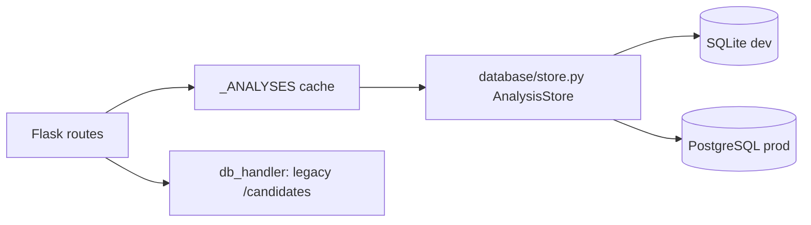

# Analysis database

Authoritative store for v1 analyses + append-only review audit.
SQLite locally, PostgreSQL in production. No silent in-memory fallback:
if the database is unreachable the API fails clearly (503/500 with a
generic message; details server-side only).

## Architecture



- `database/models.py` — `Analysis` (scores, report, provenance, version,
  soft-delete) + `ReviewEvent` (append-only) + `SchemaVersion`.
- `database/migrations.py` — ordered idempotent revisions; `upgrade()` runs
  at startup and via `manage_db.py upgrade`. No Alembic: the app has no
  app-factory/Flask-SQLAlchemy, so two-table versioned migrations are
  lighter and fully reviewable. Adopt Alembic if the schema grows.
- `database/store.py` — the only persistence interface. Transactions cover
  score updates + audit inserts; `version` gives optimistic locking (409 on
  stale `expected_version`).

Legacy `db_handler` (Mongo/JSON candidate list) still serves `/candidates`,
`/compare`, `/stats`. New v1 analysis ids are `uuid4().hex` (32 chars).

## Configuration

| Variable | Dev default | Production |
|---|---|---|
| `DATABASE_URL` | `sqlite:///<repo>/data/analyses.db` | `postgresql+psycopg://...` (required) |
| `MONGO_URI` | empty (JSON fallback) | set for candidate list, or leave for JSON |
| `RETENTION_DAYS` | 90 | set per policy |

PostgreSQL needs a driver (`pip install psycopg[binary]`); without one the
startup error says exactly that, with no credentials shown.

## Migrations

```bash
cd backend
python manage_db.py version   # current schema version
python manage_db.py upgrade   # apply pending revisions
```

Startup runs `upgrade()` automatically and refuses to serve a half-migrated
schema. Current schema: **v1** (`analyses`, `review_events`, `schema_version`).

## Retention / deletion

- Raw resume **text** is never stored in the database (metadata + scores only).
- Uploaded resume **files** live in `data/resumes/` under generated names.
- `DELETE /api/v1/analyses/<id>` soft-deletes the record and removes the file.
- `python manage_db.py prune [--dry-run]` soft-deletes records older than
  `RETENTION_DAYS`. File cleanup for pruned records is manual (documented in
  the command output) until object storage lands.
- Privacy note: analyses contain candidate PII (name/email). Restrict DB
  access, encrypt backups, and honour deletion requests within `RETENTION_DAYS`.
